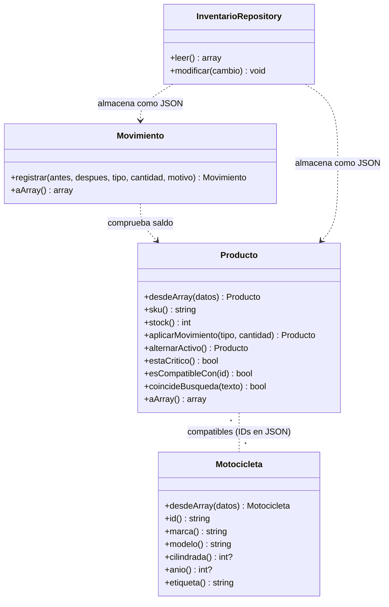

# Arquitectura y modelos de dominio — Moto Repuestos Medrano

## Respuesta a la observación docente

La versión inicial separaba `index.php` (interfaz) y `src/store.php` (funciones de negocio y persistencia), pero **no declaraba clases o modelos de dominio**. En esta versión se adoptó un **enfoque orientado a objetos en el dominio y la persistencia**, manteniendo el archivo `store.php` como fachada de compatibilidad con la interfaz existente.

**No se afirma que el proyecto sea MVC completo.** `index.php` aún mezcla presentación con control de formularios; es una adaptación gradual hacia una arquitectura por capas.

## Clases reales y su responsabilidad

| Archivo | Clase PHP | Responsabilidad y métodos |
|---|---|---|
| `src/Models/Producto.php` | `MotoMedrano\Models\Producto` | Entidad repuesto (`sku`, `stock`, `minimo`, `activo`, compatibilidad); `desdeArray`, `aplicarMovimiento`, `alternarActivo`, `coincideBusqueda`, `estaCritico`, `esCompatibleCon`, `aArray`. |
| `src/Models/Motocicleta.php` | `MotoMedrano\Models\Motocicleta` | Referencia de motocicleta (`id`, marca, modelo, cilindrada, año); `desdeArray`, `etiqueta`, `aArray`. |
| `src/Models/Movimiento.php` | `MotoMedrano\Models\Movimiento` | Registro validado de entrada/salida, con saldo anterior y posterior; `registrar`, `aArray`. |
| `src/Repositories/InventarioRepository.php` | `MotoMedrano\Repositories\InventarioRepository` | Lee y persiste `data/inventario.json` utilizando `flock()`; `leer`, `modificar`. |

## Relaciones entre clases



## Flujo real de una entrada o salida

1. `index.php` recibe la solicitud e invoca `save_movement()` (en `src/store.php`).
2. `save_movement()` llama a `update_database()`, que utiliza `InventarioRepository::modificar()` con bloqueo de archivo.
3. Dentro del cambio se crea `Producto::desdeArray()` y se utiliza `Producto::aplicarMovimiento()` para validar el saldo.
4. `Movimiento::registrar()` verifica la coherencia entre cantidad, tipo y existencias antes/después.
5. El repositorio escribe `data/inventario.json` con el historial y el nuevo stock en una sola operación bloqueada.

Las funciones `read_database`, `update_database`, `save_product`, `save_movement`, `toggle_product`, `find_product` y `find_vehicle` permanecen para **no modificar `index.php`**. Ahora delegan operaciones en las clases.

## Datos de demostración

Los 278 productos del catálogo y 121 referencias de motocicletas siguen integrados en `store.php`. El stock y las ubicaciones A–Z / estantes 01–40 de demostración se identifican como ficticios. Las relaciones por coincidencia de nombres son orientativas y **no certifican compatibilidad mecánica**.

## Ejecución de pruebas

Desde Git Bash, en la carpeta del proyecto:

```bash
/c/xampp/php/php.exe tests/pruebas_almacen.php
/c/xampp/php/php.exe tests/pruebas_modelos.php
```

Ambos scripts utilizan archivos JSON temporales y no sobrescriben el inventario real.
